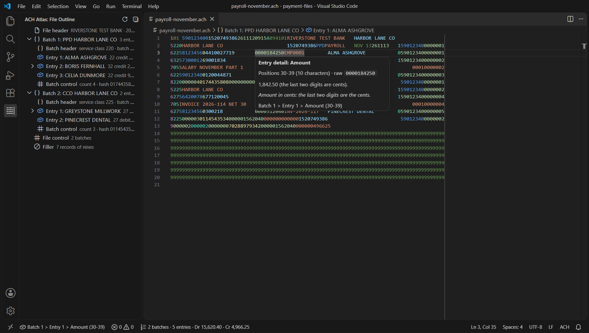
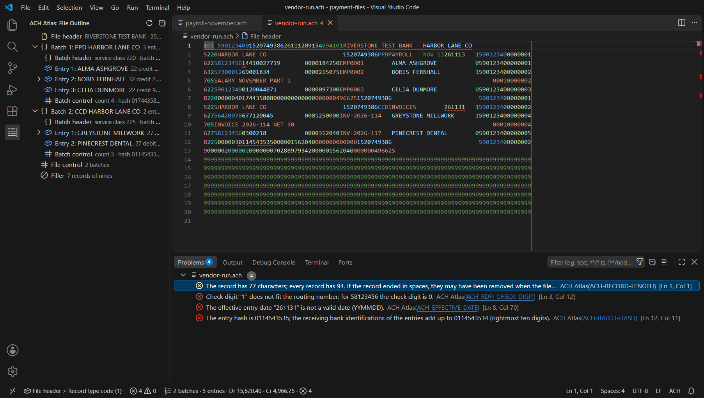
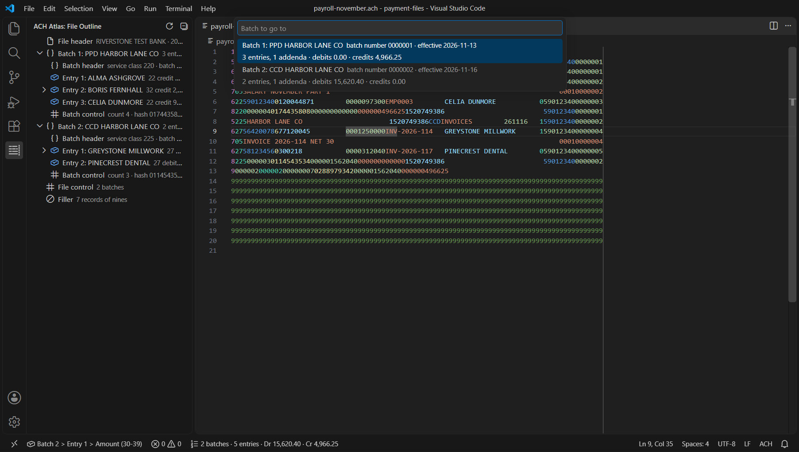
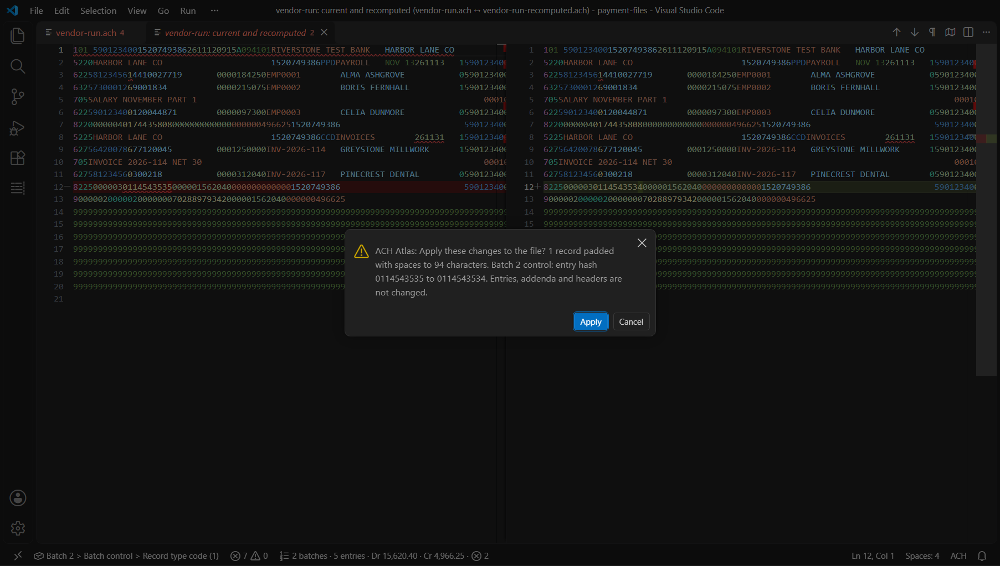
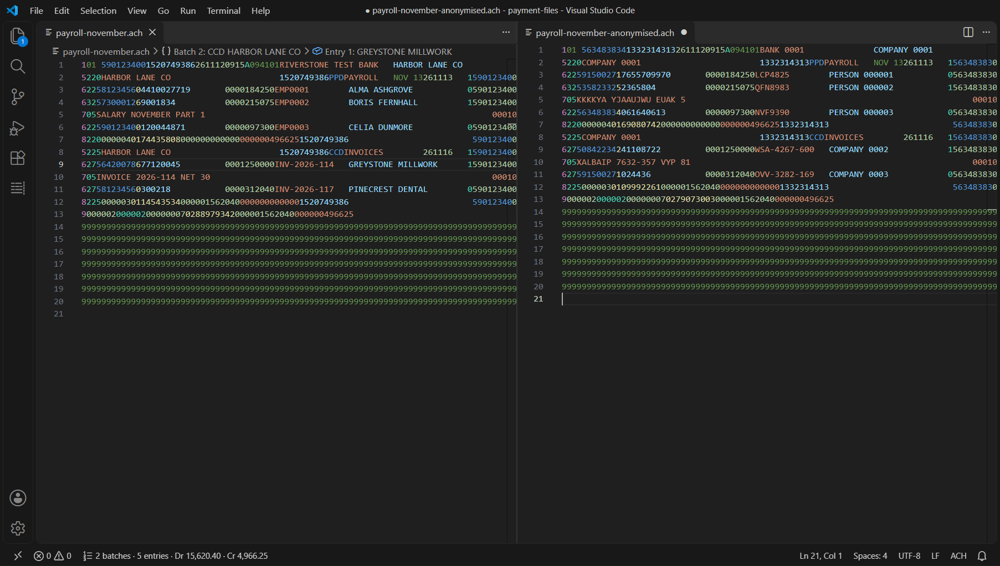

# ACH Atlas

**Read, check and fix ACH payment files in VS Code.** ACH Atlas shows the batches, entries and addenda of a file in an outline, explains every field of the 94-character records in a hover (amounts with their cents, dates with the weekday, routing numbers with their check digit), recomputes the counts, entry hash and debit and credit totals from the entries and lists every difference as a problem with a stable code. **Pro** creates test files with correct totals, anonymises files before you share them, recomputes the control records, compares two files, exports the entries and reports on a whole folder.

Made for payments, payroll, treasury and bank-integration teams who produce or receive US ACH files (the file format published by Nacha) and need to see quickly why a file does not add up. Everything runs on your computer, with no telemetry and no account.

## Screenshots

The File Outline and a hover on an amount:

Problems with codes, found in a sample file:

Go To Batch, with the field at the cursor and the file totals in the status bar:

Recompute Control Records And Padding (Pro) shows the difference before anything changes:

An anonymised copy (Pro) next to the original:

## Free, trial and Pro

| Feature | Free | Trial (14 days) | Pro |
| --- | :---: | :---: | :---: |
| ACH language for `.ach` and `.nacha` files and detection of ACH files saved as text, field colours, ruler at column 94 | yes | yes | yes |
| File Outline view, Outline view, breadcrumbs and folding by batch | yes | yes | yes |
| Hover: field name, positions, raw value and meaning; control fields with the computed value | yes | yes | yes |
| Problems with stable codes: record length and order, counts, entry hash, totals, blocking, check digits, codes, dates, addenda, trace numbers | yes | yes | yes |
| Copy Field Path At Cursor, Go To Batch, Show File Totals, status bar totals | yes | yes | yes |
| Samples, walkthrough, Report A Problem | yes | yes | yes |
| Create Test File (PPD, CCD, CTX, WEB, TEL) with correct totals, hash, check digits and filler | | yes | yes |
| Anonymise File and Anonymise Folder, with consistent replacements and adjusted controls | | yes | yes |
| Recompute Control Records And Padding, with a preview of the difference | | yes | yes |
| Compare With Another File (Markdown and CSV report) | | yes | yes |
| Export Entries As CSV or JSON | | yes | yes |
| Reconciliation report for a folder (HTML and CSV) | | yes | yes |
| Split Into One File Per Batch, Merge Files | | yes | yes |

* **Free** needs no key, no account and no network connection, for personal and commercial use. Free features will not be moved behind the key later.
* **Trial**: the first Pro command you run starts a free 14-day trial of every Pro feature on this computer. It is recorded only in the editor's storage on this computer (nothing is sent anywhere) and needs no key or account. **ACH Atlas: Show Licence Status** shows the days left.
* **Pro** is a one-time purchase, not a subscription: **Pro Personal USD 29** (one person, up to 3 computers, use at work allowed) or **Pro Business USD 59 per user** (for organisations; one key per user, each for up to 3 computers). Prices at the time of writing; the checkout page shows the final price and any taxes for your country. **ACH Atlas: Buy Pro** opens the checkout, the key arrives by e-mail, **ACH Atlas: Enter Licence Key** activates it. Pro is sold outside the Visual Studio Marketplace.

## Quick start

1. Install **ACH Atlas** from the Extensions view (publisher Small Steps Studio). Requires VS Code 1.82 or newer.
2. Open an `.ach` or `.nacha` file, a `.txt` or `.dat` file that starts with an ACH file header, or run **ACH Atlas: Open Sample File** for an invented sample.
3. Click the ACH Atlas icon in the activity bar for the **File Outline**; rest the pointer on any field for its meaning.
4. Open the Problems view; run **ACH Atlas: Open Sample File With Problems** to see four typical ones.
5. **Help > Welcome > Get started with ACH Atlas** walks through the rest in five steps.

More: [Getting started](docs/getting-started.md), [Problems and codes](docs/problems.md), [Record layouts](docs/record-layouts.md), [Pro tools](docs/pro-tools.md), [Licence, trial and Pro](docs/licence.md), [Troubleshooting](docs/troubleshooting.md), [Changelog](CHANGELOG.md).

## Features in detail

### Reading the file

Every record of an ACH file is 94 characters: a file header (1), batches made of a batch header (5), entry details (6) with their addenda (7) and a batch control (8), then a file control (9) and filler records of nines. ACH Atlas gives each field its own colour, shows a ruler at column 94 and keeps the trailing spaces of ACH files when you save (trimming is turned off for the ACH language). Files without line breaks are read as consecutive 94-character records.

The **File Outline** lists the file header, every batch (SEC code, company, entry count, debits, credits, effective date), its entries (name, transaction code, amount, addenda count) and addenda, the controls and the filler. Large batches are paged by 500 entries, so even a file with half a million entries (about 47 MB) opens at once, after you raise `achAtlas.maxFileSizeMB` above its default of 20. The editor's Outline view and breadcrumbs show the same structure, and batches can be folded.

### Hover

On any field: the record and field name, the positions and length, the raw characters (spaces shown as dots) and what they mean, for example:

* amounts with the implied decimal point: `0000184250` is 1,842.50;
* dates with the weekday, times as HH:MM;
* routing numbers with the result of their check digit, and the correct digit when it is wrong;
* transaction codes as account type and direction (22: checking account, credit; 38: savings account, prenotification of a debit);
* SEC codes, service class codes, addenda types and the common return reason codes and change codes in plain words;
* for counts, entry hash and totals in the batch and file controls: the value computed from the entries and whether it matches.

All field positions are listed in [docs/record-layouts.md](docs/record-layouts.md).

### Problems

The file is checked while you type. Every problem appears in the Problems view with a code, a severity and a message that names what was found and what was expected:

* record length 94, record types, record order, printable ASCII, empty lines, byte order mark;
* batch control and file control: entry/addenda counts, entry hash, total debits and credits, batch count, block count, and agreement with the batch header (service class, company identification, originating bank, batch number);
* blocking factor and filler records to a multiple of ten;
* the routing-number check digit of every entry and of the immediate destination;
* transaction codes, and service class 220 or 225 against the direction of each entry;
* SEC code families: PPD, CCD, CTX, WEB and TEL in detail, IAT in its basic fields and addenda;
* effective entry dates (valid, not before the creation date, not far ahead, not on a weekend), company identification, entry description, originator status;
* addenda indicators, addenda types and counts per SEC code, addenda sequence numbers;
* trace numbers: unique in the file, ascending in a batch, starting with the originating bank;
* amounts that are not digits, prenotifications with an amount, live entries without one.

All amounts, hashes and counts are computed with exact integer arithmetic. The complete list of codes is in [docs/problems.md](docs/problems.md). These are format checks: they do not tell you whether a bank will accept a file, because banks apply further rules of their own.

### Totals and navigation

The status bar shows the field at the cursor (`Batch 1 > Entry 2 > Amount (30-39)`, click to copy) and the batches, entries, debits and credits of the file with its problem counts. **Show File Totals** gives the totals and the entry hash and copies a per-batch summary; **Go To Batch** jumps to a batch.

### Create Test File (Pro)

Six short questions (SEC code, direction, number of entries up to 100,000, number of batches, amount range, effective date) and whether to add addenda; the result is a complete file of invented entries with correct batch and file controls, entry hash, check digits, ascending trace numbers and filler. The invented routing numbers start with 5, a range not assigned to banks, so they never point to a real institution. Details in [docs/pro-tools.md](docs/pro-tools.md).

### Anonymise File and Anonymise Folder (Pro)

Replaces names, account numbers, identification numbers, company names and identifications, bank names, routing numbers (in the file header, batch headers, entries, trace numbers and return or change addenda) and free-text addenda. One mapping per run keeps the same value the same everywhere, also across the files of a folder; new routing numbers keep valid check digits; the entry hash and totals are adjusted, so a correct file stays correct. Amounts can be kept or replaced. In a folder run, files in which nothing was found to replace are reported as unchanged and not written. Every run draws a new random 256-bit key from which all replacements are derived; the key is kept in memory only and never saved, so a copy cannot be turned back without it, the same value always gets the same replacement within a run and two different values never share one. What a copy still shows is which values were equal and everything that is kept (see the documentation).

### Recompute Control Records And Padding (Pro)

Rewrites every batch control and the file control from the entries, pads records whose trailing spaces were lost, and sets the filler records. It shows the current and the recomputed file side by side first and changes nothing until you confirm; Undo reverts it. Entries, addenda and headers are never changed.

### Compare, export, reconcile, split and merge (Pro)

* **Compare With Another File**: the whole file is compared: file header, batch headers, batch controls, file control, filler, records out of place, batches and entries matched (by trace number, or ignoring trace and batch numbers), every added, removed or changed entry with its fields, totals of both files; options to ignore dates. The exact text is compared too: the byte order mark, empty lines, and every record character by character including its length (records without their trailing spaces, characters after position 94, records at another position). Not compared: the style of the line breaks. "No differences" is reported only when none of the compared items differs. Markdown and CSV.
* **Export Entries As CSV / JSON**: one row per entry with its batch; exact decimal amounts; CSV cells that a spreadsheet would read as a formula get a leading apostrophe (setting `achAtlas.export.neutraliseFormulas`, on by default).
* **Create Reconciliation Report For A Folder**: totals by file, batch, effective date and SEC code, debits against credits, and anomalies (files with errors, trace numbers used in two files, possible duplicate batches, returns and notifications of change). HTML without scripts, and CSV.
* **Split Into One File Per Batch** and **Merge Files**: complete files with recomputed controls; every split file gets its own file ID modifier; Merge refuses files for different destinations. Both refuse automated accounting advice batches.

## Commands

| Command | Tier |
| --- | :---: |
| ACH Atlas: Check Current File | Free |
| ACH Atlas: Copy Field Path At Cursor | Free |
| ACH Atlas: Go To Batch | Free |
| ACH Atlas: Show File Totals | Free |
| ACH Atlas: Open Sample File / Open Sample File With Problems | Free |
| ACH Atlas: Open Getting Started Guide | Free |
| ACH Atlas: Show Documentation | Free |
| ACH Atlas: Report A Problem | Free |
| ACH Atlas: Buy Pro | Free |
| ACH Atlas: Enter Licence Key | Free |
| ACH Atlas: Show Licence Status | Free |
| ACH Atlas: Remove Licence From This Machine | Free |
| ACH Atlas: Create Test File | Pro |
| ACH Atlas: Anonymise File | Pro |
| ACH Atlas: Anonymise Folder | Pro |
| ACH Atlas: Recompute Control Records And Padding | Pro |
| ACH Atlas: Compare With Another File | Pro |
| ACH Atlas: Export Entries As CSV | Pro |
| ACH Atlas: Export Entries As JSON | Pro |
| ACH Atlas: Create Reconciliation Report For A Folder | Pro |
| ACH Atlas: Split Into One File Per Batch | Pro |
| ACH Atlas: Merge Files | Pro |

The editor context menu of ACH files has an **ACH Atlas** submenu; the Explorer folder menu offers the reconciliation report and Anonymise Folder. No keyboard shortcuts are assigned; add your own in the Keyboard Shortcuts editor.

## Settings

| Setting | Default | Description |
| --- | --- | --- |
| `achAtlas.maxFileSizeMB` | `20` | Largest file checked automatically and given hovers and the outline. Larger files are checked with **Check Current File**. |
| `achAtlas.maxProblems` | `1000` | Largest number of problems listed per file. |
| `achAtlas.validateOnType` | `true` | Check while typing (after a pause); files above 2 MB are checked when opened and saved. |
| `achAtlas.hover.enabled` | `true` | Show hovers. |
| `achAtlas.detectPlainText` | `true` | Switch plain text files to the ACH language when their first record is an ACH file header. |
| `achAtlas.checks.effectiveDate` | `true` | Report effective dates before the creation date, more than 60 days after it, or on a weekend. |
| `achAtlas.checks.blocking` | `true` | Report record counts that are not a multiple of ten (filler records). |
| `achAtlas.reconcile.include` | `**/*.{ach,nacha,txt,dat}` | Files read by the reconciliation report and Anonymise Folder. |
| `achAtlas.reconcile.maxFiles` | `2000` | Largest number of files the folder commands read. |
| `achAtlas.export.neutraliseFormulas` | `true` | Put an apostrophe in front of CSV cells that a spreadsheet would run as a formula. |

## FAQ

**Will my bank accept a file without problems in ACH Atlas?** ACH Atlas checks the file format and the totals inside the file. Banks and processors apply further rules (cut-off times, limits, allowed SEC codes, account checks, their own form of the file header), so a file can pass every check here and still be refused. You stay responsible for the files you send.

**What does Pro include?** Create Test File, Anonymise File and Folder, Recompute Control Records And Padding, Compare, the CSV and JSON export, the reconciliation report, Split and Merge. Everything else is free and stays free.

**What does it cost?** Pro Personal USD 29 once, or Pro Business USD 59 once per user, at the time of writing. No subscription, no renewal.

**On how many computers?** Each key works on up to 3 computers at the same time. **Does the key expire?** No.

**Can I try before buying?** Yes: the free features need no key, and the first Pro command starts a free 14-day trial of every Pro feature on this computer, without key, account or network.

**How do I move a licence to another computer?** Run **ACH Atlas: Remove Licence From This Machine** on the old computer, then **Enter Licence Key** on the new one.

**What happens offline?** The free features and the trial need no network. A licence is checked at most once a day; if the licence service cannot be reached, the last successful check keeps Pro working for 14 days.

**Is any file uploaded?** No. Files, reports, test files and anonymised copies stay on your computer.

**Which file sizes?** Files up to 20 MB are checked automatically (setting `achAtlas.maxFileSizeMB`); up to 50 MB, the largest file the editor hands to extensions, on demand. The test suite checks a file of 500,000 entries.

**Which systems?** VS Code 1.82 or newer. ACH Atlas is plain JavaScript without platform-specific code; it was tested on Windows. It was not tested on macOS, Linux or in remote workspaces.

## For IT and procurement

* Publisher: Small Steps Studio (publisher id `SmallStepsStudio`); extension id: `SmallStepsStudio.ach-atlas` (for extension allow lists).
* Network: the only host the extension contacts is `live.dodopayments.com`, and only for the licence check after a key has been entered. The free features and the trial make no network requests. No setting or command switches the licence check to another host.
* No telemetry, no usage statistics, no crash reporting, no file upload.
* Marketplace page: <https://marketplace.visualstudio.com/items?itemName=SmallStepsStudio.ach-atlas>.
* Source code: public at <https://github.com/small-steps-studio/ach-atlas>; plain JavaScript without bundled third-party components.
* Licences: one key per person (Personal) or per user (Business), each for up to 3 computers. Purchases go through the online checkout of Dodo Payments, the merchant of record, which issues the invoice (with company name and tax ID when "Purchasing as a business" is ticked).
* We sell only through the online checkout. We cannot accept purchase orders, invoices with payment terms, custom contracts or vendor questionnaires.

## Limits and good to know

* **Format checks only.** No bank, network or operator acceptance is checked or implied.
* **SEC codes.** PPD, CCD, CTX, WEB and TEL are checked in detail; IAT in its basic fields, addenda count and order. Other SEC codes are read and totalled without their code-specific checks. Automated accounting advice batches (ADV) are listed but not checked or recomputed; Split, Merge and Recompute refuse them, and Anonymise replaces their account numbers, names and routing numbers without touching amounts or totals.
* **Returns and notifications of change** are shown and explained in the hover; they are not processed further.
* **Bank holidays** are not known; only weekends are reported for effective dates.
* **Size.** Files up to `achAtlas.maxFileSizeMB` are analysed automatically; records are kept as offsets into the text, so memory grows little beyond the size of the file.
* **Untrusted workspaces.** All features are available; files are written only where you confirm.

## Privacy

ACH Atlas has no telemetry and sends none of your files, file names or field values anywhere. Reading, checking, test files, anonymising, comparing, exports, reports and the trial all happen locally.

The only network request is the licence check of the Pro tier, and only after you have entered a licence key. It sends the licence key and the text `VS Code on <platform>` (for example `VS Code on Windows`; never your computer's name) to the licence service of the payment provider, to activate, validate or deactivate the key. A successful check is remembered for 24 hours, and if the service cannot be reached the last successful check keeps Pro working for 14 days. Without a licence key the extension makes no network requests at all. The full statement is in [PRIVACY.md](PRIVACY.md).

Data disclosure for the licence check:

* **When it happens.** After you enter a key: when you run **Enter Licence Key**, **Show Licence Status** or **Remove Licence From This Machine**, and on its own at your next use of a Pro feature once the last successful check is older than 24 hours. Never without a key; never for the free features or the trial; not for **Report A Problem**, which reads the stored state only.
* **What is sent.** The licence key, the label `VS Code on <platform>` (activation only) and the activation id the service returned (validation and deactivation). Nothing else: no file contents, file names, field values, user name, computer name, workspace path or usage statistics. The service also sees your IP address, as any web service does.
* **Who receives it.** Dodo Payments, the payment provider and merchant of record that sold the key, at `live.dodopayments.com`. Nobody else.
* **Where it goes and how long it is kept.** The provider may process data in several countries and keeps it as its own privacy policy states: <https://dodopayments.com/legal/privacy-policy>. The extension keeps the key (in the editor's secret storage), the activation id and the product id only on your computer, until you remove the licence. The customer details in the provider's answer (name, e-mail address) are never stored.
* **Anonymity.** Not anonymous: a licence key belongs to a purchase and therefore to the buyer's record at the payment provider. The platform label contains no personal data.

## Names

Nacha is the name of the organisation that publishes the rules and the file format for ACH payments in the United States; "ACH" stands for Automated Clearing House. These names are used here only to say which file format the extension reads. ACH Atlas is an independent product with no affiliation to, approval by or endorsement from Nacha or any other organisation. It contains no text from the Nacha Operating Rules: the field descriptions are written for ACH Atlas, and field positions and lengths are facts of the published file layout. All sample data, names, companies, banks and routing numbers are invented.

## Support

Questions, bug reports and requests: <https://github.com/small-steps-studio/ach-atlas/issues>. In the editor, **ACH Atlas: Report A Problem** copies a diagnostics block (versions, platform, settings, licence state; no file contents, names or values, no key) and opens that page. Please attach only files with invented data, and never post a licence key.

## Licence and terms

The free features may be used without charge; Pro features need a paid licence key after the trial. See [LICENSE.txt](LICENSE.txt) and [TERMS.md](TERMS.md). Purchases are processed by the payment provider as merchant of record; its buyer terms apply to payment, invoices and refunds.
